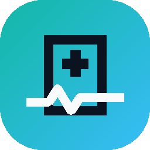
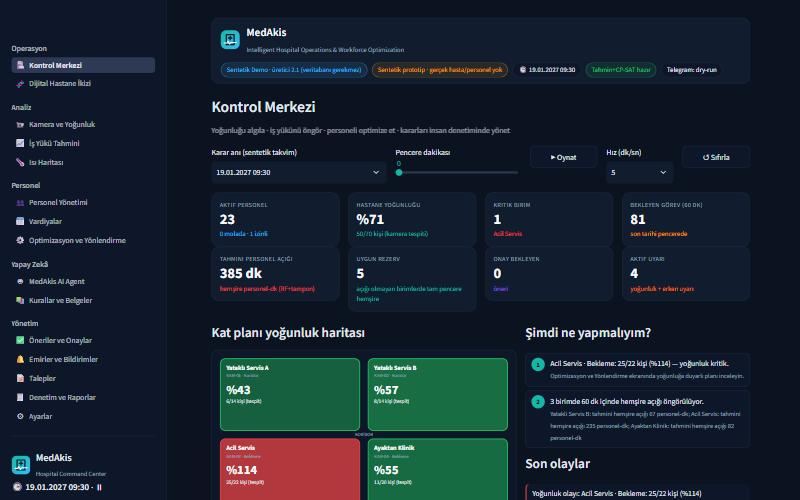
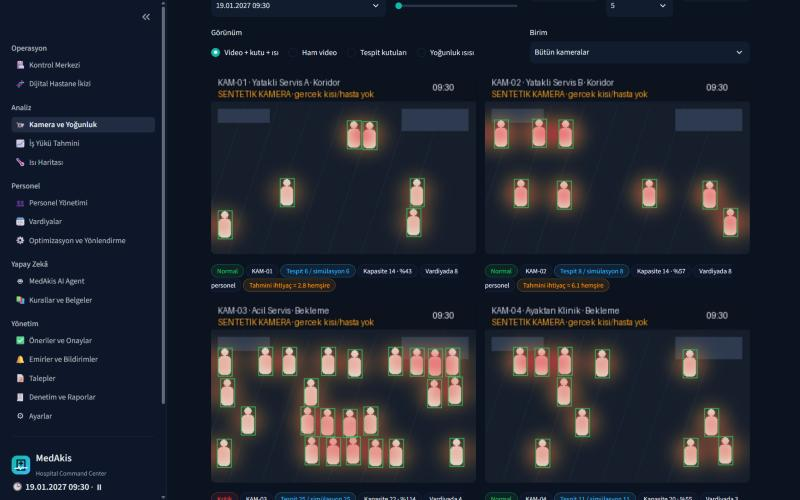
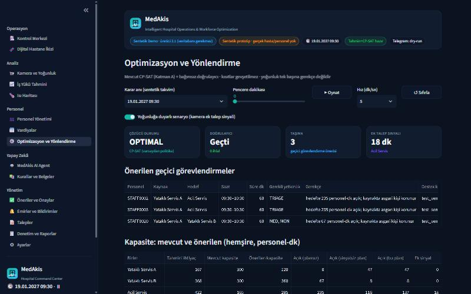
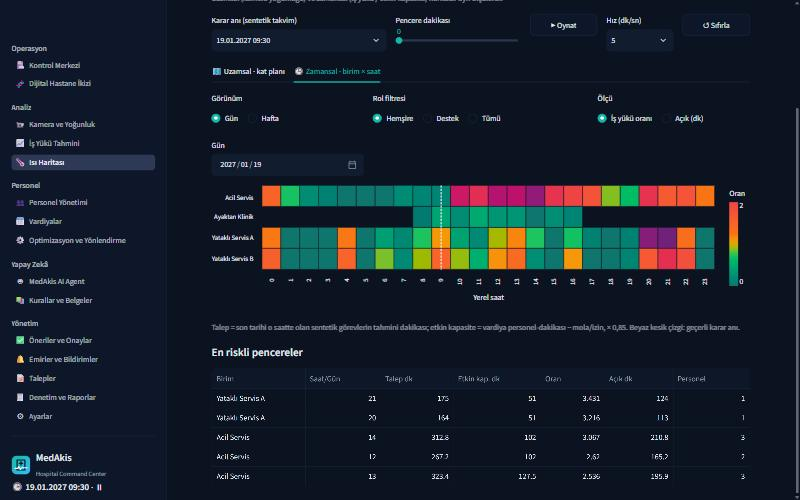
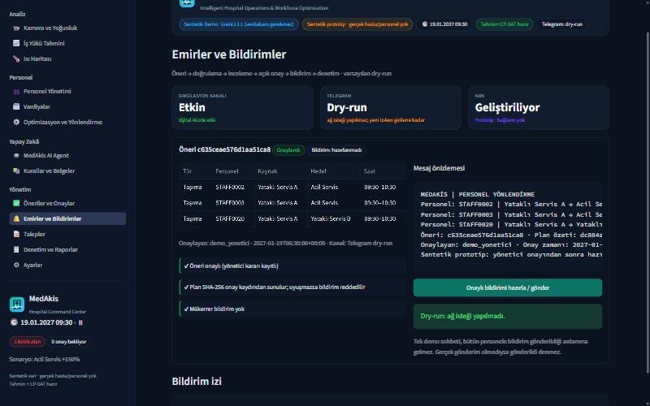
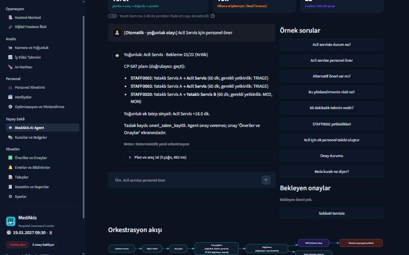
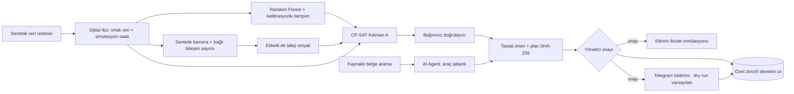

<div align="center">



# MedAkis

### Intelligent Hospital Operations & Workforce Optimization

**Yoğunluğu algıla. İş yükünü öngör. Personeli optimize et. Kararları insan denetiminde yönet.**

`Python` · `Streamlit` · `OR-Tools CP-SAT` · `scikit-learn` · `Dijital İkiz` · `BGE-M3` · `Gemma 3 (yerel)` · `Telegram`

</div>



*Gerçek uygulama ekranı: Kontrol Merkezi, sentetik "acil servis kritik yoğunluk" senaryosu.*

> **Sentetik prototip.** MedAkis tamamen **sentetik veriyle** çalışan bir karar destek prototipidir; gerçek hastanede
> doğrulanmamıştır ve klinik ürün değildir. Kamera görüntüleri programatik olarak üretilir; gerçek kişi, yüz, kimlik ya da
> biyometrik veri işlenmez. Hiçbir ekran gerçek personel ataması yapmaz.

## 1. Çözülen problem

Acil servis birden dolduğunda yönetici; hangi alanın gerçekten zorlandığını, hangi birimde kapasite kaldığını, kimin rolü,
yetkinliği ve vardiyasının uygun olduğunu ve görevlendirmenin kaynak birimi riske atıp atmadığını dakikalar içinde
değerlendirmek zorundadır. Bu bilgiler genellikle farklı sistemlerdedir ve karar çoğu zaman sezgiyle verilir.

## 2. Yaklaşım

| Adım | MedAkis ne yapar |
|---|---|
| **Algıla** | Sentetik kamera akışında anonim figürleri sayar, alan doluluğunu kat planında gösterir |
| **Öngör** | Random Forest ve kalibrasyonlu tampon ile 30/60 dakikalık iş yükünü personel-dakika olarak tahmin eder |
| **Optimize et** | CP-SAT, rol, yetkinlik, vardiya, mola, asgari personel ve destek kurallarını koruyarak geçici görevlendirme önerir; bağımsız doğrulayıcı planı yeniden denetler |
| **İnsan denetiminde yönet** | Öneri plan SHA-256 özetine bağlanır; yalnız yönetici onaylar. Onaylı etki dijital ikizde simüle edilir, bildirim hazırlanır, her adım özet zincirli denetim izine yazılır |

## 3. Ekranlar

| Grup | Ekran | Ne sunar |
|---|---|---|
| Operasyon | 🏥 **Kontrol Merkezi** | Hesaplanan KPI'lar, kat planı yoğunluk haritası, "Şimdi ne yapmalıyım?", olaylar, iş yükü ve kapasite grafikleri, yapay zekâ önerisi |
| | 🧬 **Dijital Hastane İkizi** | Merkezi simülasyon saati, hazır/özel yoğunluk senaryoları, what-if analizi, onaylı planın simüle etkisi |
| Analiz | 📹 **Kamera ve Yoğunluk** | Dört sentetik kamera, tespit kutuları ve yoğunluk ısısı, oynat/durdur/hız, birim seçimi, geçmiş, kritik olaylar |
| | 📈 **İş Yükü Tahmini** | RF 30/60 dk tahmin, tampon, etkin kapasite, açık ve rezerv, erken uyarılar, tahmin–gerçekleşen karşılaştırması |
| | 🌡️ **Isı Haritası** | Uzamsal (kamera doluluğu) ve zamansal (birim × saat iş yükü oranı) harita; gün/hafta, rol filtresi, hücre ayrıntısı |
| Personel | 👥 **Personel Yönetimi** | Vardiyadaki personel, geçerlilik tarihli yetkinlikler, mola/izin, rezerv havuzu, bekleyen yönlendirmeler |
| | 🗓️ **Vardiyalar** | Günlük Gantt (mola aralıklarıyla), saatlik kapsama, haftalık vardiya matrisi |
| | ⚙️ **Optimizasyon ve Yönlendirme** | Mevcut CP-SAT + doğrulayıcı, yoğunluk sinyali, aday/elenme gerekçeleri, kapasite karşılaştırması, manuel yönlendirme denetimi |
| Yapay Zekâ | 🤖 **MedAkis AI Agent** | Araç tabanlı agent: plan, araç çağrıları ve süreleri, kaynaklar, taslak öneri; kritik olayda otomatik taslak |
| | 📚 **Kurallar ve Belgeler** | Kontrollü belge listesi, kaynaklı arama (sürüm, skor, doğrulanmış alıntı), desteklenmeyen soruda güvenli ret |
| Yönetim | ✅ **Öneriler ve Onaylar** | Onay, ret, alternatif isteme, geri alma; plan özeti ve güncellik kontrolü; onay öncesi/sonrası what-if |
| | 🔔 **Emirler ve Bildirimler** | Onaylı öneri kartları, mesaj önizlemesi, Telegram (varsayılan dry-run), mükerrer engeli, bildirim izi |
| | 📝 **Talepler** | Ek personel / geçici görevlendirme talepleri, karar kaydı, agent ve araç çağrısı izleme |
| | 🧾 **Denetim ve Raporlar** | Bütünleşik özet zincirli denetim izi, açıklanabilirlik, JSON dışa aktarma |
| | ⚙ **Ayarlar** | Yoğunluk eşikleri, otomatik taslak, bileşen durumları, tema |

| Kamera ve Yoğunluk | Optimizasyon ve Yönlendirme |
|---|---|
|  |  |
| **Isı Haritası (zamansal)** | **Emirler ve Bildirimler (dry-run)** |
|  |  |
| **MedAkis AI Agent** | |
|  | |

*Bütün görüntüler uygulamanın gerçek ekranlarıdır (sentetik veri, 19.01.2027 09:30 karar anı, "Acil kritik yoğunluk" senaryosu).
Doğrudan bu senaryoyla açmak için: `http://localhost:8501/?senaryo=acil_kritik`.*

## 4. Dijital Hastane İkizi

Bütün ekranlar **tek bir veri kaynağını ve tek bir simülasyon saatini** paylaşır. Saat; sentetik takvimde değerlendirilmiş
karar anları ve her anın 60 dakikalık penceresi boyunca ilerler. Saat değiştiğinde kameralar, yoğunluk, ısı haritası,
vardiya durumu, tahmin, olaylar, optimizasyon ve agent birlikte güncellenir. Senaryolar (ör. acil +%150, poliklinik −%40,
bir hemşireyi taşıma, izin, ek personel) gerçek atama yapmadan mevcut ve önerilen durumu, değişimi ve güvenlik
kontrollerini gösterir. Onaylanan planın etkisi yalnız ikizde simüle edilir; **Sıfırla** her şeyi başlangıca döndürür.

## 5. Sentetik kamera ve yoğunluk

Kamera kareleri koddan üretilir (`src/medakis/density/camera.py`): alandaki kişi sayısı birimin o andaki aktif hasta
kaydından ve yapılandırılmış alan katsayısından türetilir, figürler ayrı yerleşim yuvalarında hareket eder. Dedektör yalnız
sentetik karede çalışır: açık renkli pikselleri eşikler, bağlı bileşenleri bulur ve kutu çizer. Tespit ile simülasyon
gerçeği yan yana gösterilir. **Bu yöntem gerçek kamerada doğrulanmış insan tespiti değildir.**

## 6. Isı haritaları

- **Uzamsal:** kat planında kamera doluluğu (kişi / alan kapasitesi), yapılandırılabilir yeşil–sarı–turuncu–kırmızı eşikler.
- **Zamansal:** birim × saat iş yükü oranı = görev talebi (sentetik görevlerin tahmini dakikası) / etkin kapasite (vardiya
  personel-dakikası − mola/izin, × 0,85). Kamera yoğunluğu ile iş yükü oranı **ayrı ölçülerdir** ve karıştırılmaz.

## 7. İş yükü tahmini

Mevcut Random Forest modelleri ve U1 kalibrasyonlu tampon kullanılır (yeniden yazılmadı). Tahminler **personel-dakika**
cinsindendir, kişi sayısı değildir. Kamera yoğunluğu modelin girdisi değildir; yalnız yoğunluğa duyarlı senaryoda ayrı
etiketli **ek talep sinyali** olarak eklenir. Model dosyası yoksa uygulama sahte tahmin göstermez.

## 8. Yoğunluğa duyarlı optimizasyon

Mevcut Katman A CP-SAT modeli **kısıtlar gevşetilmeden** çalışır ve her sonuç bağımsız doğrulayıcıdan geçer. Kamera
yoğunluğu tek başına görevlendirme gerekçesi değildir: kapasite üstü her kişi için yapılandırılmış dakika, yalnız açık
takvimli hemşire talebine eklenir ve sonuçta ayrı gösterilir. Yayınlanabilir plan yoksa **güvenli ret** verilir. Ekranda
personel, kaynak, hedef, süre, gerekçe, mevcut/önerilen kapasite, elenen adaylar ve gerekçeleri, kural kontrolleri ve onay
durumu görünür.

## 9. MedAkis AI Agent

Agent; yoğunluk, birim durumu, personel, uygunluk, yetkinlik, vardiya, tahmin, kapasite, optimizasyon, doğrulama, simülasyon,
kaynak arama, taslak öneri, taslak talep ve onay durumu araçlarını çağırır. Yanıttaki her sayı araç çıktısından gelir. Yerel
Gemma 3 4B (Ollama) varsa yanıt yeniden ifade edilebilir; modelin eklediği her sayı araç çıktısında yoksa model çıktısı
atılır. Model yoksa agent deterministik kipte çalışır ve bunu açıkça yazar. **Agent onay veremez, atama yapamaz, bildirim
gönderemez.** LangGraph ve MCP sunucusu "Geliştiriliyor — Prototip" durumundadır; MCP çağrısı yapılmaz ve kaydı üretilmez.

## 10. Kaynaklı belge arama (RAG)

Kontrollü sentetik corpus üzerinde kaynaklı arama: belge adı, sürüm, bölüm, skor ve belgede doğrulanan birebir alıntı.
Kaynak bulunamazsa cevap üretilmez. Arayüzdeki arama BM25 anahtar kelime aramasıdır ve **dil modeli cevabı değildir**.
BGE-M3 + reranker (LAMAR, ModernBERT-TR) + Gemma 3 4B kaynak doğrulamalı hattı geliştirme kipindedir; kabul ölçütü (A6)
karşılanmadığı için normal kullanıcıya kapalıdır.

## 11. İnsan onayı, bildirim ve denetim

```text
Öneri → doğrulama → inceleme → açık yönetici onayı → bildirim (dry-run varsayılan) → denetim
```

- Onay mevcut onay servisinden geçer: yetki, plan SHA-256 eşleşmesi, güncellik (plan, yetkinlik, takvim, kilit) ve süre.
- Agent'ın oturumu yalnız kayda alma yetkisine sahiptir; onay yalnız yönetici oturumundadır.
- Telegram yalnız `TELEGRAM_BOT_TOKEN` ve `TELEGRAM_CHAT_ID` ortam değişkenleriyle ve `MEDAKIS_TELEGRAM_MODE=live` ile canlıdır.
  **Daha önce paylaşılmış token kullanılmaz; yeni token girilene kadar dry-run varsayılandır.** Onaysız, özeti uyuşmayan ve
  mükerrer bildirim engellenir. Tek demo sohbeti, bütün personele bildirim gönderildiği anlamına gelmez.
- Yoğunluk olayları, optimizasyonlar, agent araç çağrıları, öneriler, kararlar, bildirim denemeleri, talepler ve what-if
  senaryoları özet zincirli izlere yazılır. n8n bağlantısı "Geliştiriliyor" durumundadır.

## 12. Sistem mimarisi



Kod düzeni: `twin/` (veri sağlayıcı, motor, what-if, ortak servisler) · `density/` (sentetik kamera) · `forecasting/` ·
`optimization/` · `agent/` · `rag/` · `approvals/` · `notifications/` · `repositories/` · `ui/`.

## 13. Demo senaryosu

1. **Kontrol Merkezi** açılır (19.01.2027 09:30, doğrulanmış karar anı).
2. **Dijital Hastane İkizi** → hazır senaryo **Acil kritik yoğunluk (+%150)** → **Senaryoyu uygula**.
3. Acil bekleme alanında kişi sayısı kapasiteyi aşar; **Kamera ve Yoğunluk**'ta tespit kutuları ve ısı güncellenir.
4. Kat planı ve **Isı Haritası** kırmızıya döner; kritik yoğunluk olayı oluşur ve denetime yazılır.
5. **İş Yükü Tahmini**: 30/60 dk RF tahmini, tampon, etkin kapasite ve erken uyarılar.
6. **MedAkis AI Agent** kritik olayda otomatik taslak hazırlar: araç çağrıları ve süreleri görünür.
7. **Optimizasyon ve Yönlendirme**: CP-SAT planı, doğrulayıcı "Geçti", yoğunluk sinyali, elenen adaylar.
8. Manuel yönlendirme denetimi ve what-if ile karşılaştırma.
9. **Planı yönetici onayına gönder** → **Öneriler ve Onaylar** → **Onayla** (plan özeti ve güncellik kontrolü).
10. **Emirler ve Bildirimler** → "MEDAKİS | PERSONEL YÖNLENDİRME" mesajı → dry-run (ağ isteği yok); tekrar denemede mükerrer engeli.
11. Onaylı etki **Dijital İkiz** ve **Personel Yönetimi**'nde "onaylı taşıma · simülasyon" olarak görünür.
12. **Denetim ve Raporlar**: zincir doğrulaması ve açıklanabilirlik; agent'a "Alternatif öneri var mı?"; **Kurallar ve Belgeler**'de kaynaklı arama.

## 14. Hızlı başlangıç

Gereksinim: Windows 10/11 ve Python 3.14 (`py -3.14`). PostgreSQL, Docker ve Ollama **gerekmez**.

```powershell
git clone https://github.com/beyzademirrr/Medakis--son-.git
cd Medakis--son-
.\baslat.ps1 -ModelHazirla
```

Betik sanal ortamı kurar, bağımlılıkları yükler, tahmin modellerini sentetik veriden yerelde eğitir ve uygulamayı
`http://localhost:8501` adresinde açar. Sonraki açılışlarda `.\baslat.ps1` yeterlidir.

- Model dosyası yoksa kamera, ısı haritası, personel ve vardiya ekranları çalışır; tahmin ve optimizasyon açıkça "kapalı" görünür.
- Ollama ve `gemma3:4b` yoksa agent deterministik kipte çalışır.
- Kayıt dizini `MEDAKIS_DATA_DIR` ile seçilir (varsayılan: depodaki git dışı `data/`). Örnek ayarlar: `.env.example`.
- Klasik vardiya planı inceleme ekranı: `.\baslat.ps1 -Klasik`. Ayrıntı: [`docs/TEKNIK_KILAVUZ.md`](docs/TEKNIK_KILAVUZ.md).

## 15. Testler ve doğrulama

- `tests/test_urun_prototipi.py`: kamera üretimi ve figür sayımı, yoğunluk eşikleri, ikiz verisi ve saatlik matris,
  senaryo etkisi, saat ve onaylı taşımanın ikiz etkisi, yoğunluk sinyali, tahmin + CP-SAT + doğrulayıcı, elenme
  gerekçeleri, what-if güvenlik kontrolleri, agent araç sınırları ve araç izi, talep ve güvenli ret, öneri → onay →
  dry-run → mükerrer engeli → denetim zinciri, kaynaklı arama, dil modeli sayı denetimi, uygulama açılışı.
- Mevcut test paketi (optimizasyon kısıtları, tahmin sızıntısı, onay akışı, denetim zinciri, bildirim güvenliği, RAG) korunur.
- Uçtan uca demo gerçek tarayıcıda çalıştırıldı. Sonuçlar ve çalıştırılamayan testler: [`docs/TESLIM_DURUMU.md`](docs/TESLIM_DURUMU.md).

## 16. Güvenlik ve gizlilik

Yalnız sentetik veri; yüz tanıma, kimlik tespiti, biyometri ya da gerçek sağlık verisi yoktur. Gizli bilgiler depoya,
koda ya da kayıtlara yazılmaz; Telegram token'ı hiçbir kayda ve hata metnine düşmez. Dil modeli yalnız yerel (loopback)
adresten çağrılır.

## 17. Proje durumu

Aşama 1–8 bileşenleri (şema, sentetik veri, iş yükü kuralları, tahmin, CP-SAT ve doğrulayıcı, insan onayı ve denetim,
RAG corpus'u ve geliştirme kipindeki kaynaklı cevap hattı) korunmuş ve arayüze bağlanmıştır. Dijital ikiz, kamera,
yoğunluğa duyarlı yönlendirme, agent, bildirim ve talepler çalışan prototiptir. Ayrıntılı ve dürüst durum tablosu:
[`docs/TESLIM_DURUMU.md`](docs/TESLIM_DURUMU.md).

## 18. Yol haritası

Gerçek kamera akışında anonim kişi sayımı · LangGraph orkestrasyonu ve salt okunur/taslak MCP araç sunucusu · kaynak
doğrulamalı RAG'in bağımsız soru setiyle kabulü · yenilenmiş token ile gerçek Telegram entegrasyon testi · n8n akışı ·
veritabanlı çok kullanıcılı onay.

## 19. Üçüncü taraf bileşenler ve kaynak atfı

MedAkis aşağıdaki açık kaynak yazılımları kullanır; her biri kendi lisansına tabidir. Model ağırlıkları **bu depoda
bulunmaz**; ilgili kaynaktan ayrıca indirilir ve modelin kendi lisans koşulları geçerlidir.

| Bileşen | Kullanım | Lisans |
|---|---|---|
| Streamlit, Altair, Vega-Lite | Kullanıcı arayüzü ve grafikler | Apache-2.0 / BSD-3-Clause / BSD-3-Clause |
| Google OR-Tools (CP-SAT) | Optimizasyon | Apache-2.0 |
| scikit-learn, pandas, NumPy, SciPy | Tahmin, veri ve görüntü işleme | BSD-3-Clause |
| Pillow | Sentetik kamera karesi üretimi | MIT-CMU (HPND) |
| httpx | Yerel model ve Telegram HTTP istemcisi | BSD-3-Clause |
| ChromaDB | Vektör deposu (RAG, geliştirme kipi) | Apache-2.0 |
| SQLAlchemy, Alembic, psycopg | Veritabanı katmanı (veritabanlı mod) | MIT / MIT / LGPL-3.0 |
| Ollama | Yerel model sunucusu | MIT |
| BAAI/bge-m3 | Türkçe metin gömme | MIT |
| Google Gemma 3 4B | Yerel dil modeli (agent yeniden ifade, kanıt denetimi) | Gemma Kullanım Koşulları |
| nlpai-lab/LAMAR-600m, ytu-ce-cosmos/modernbert-tr-reranker | Reranker deneyleri | MIT / Apache-2.0 |
| Qwen/Qwen3-Reranker-0.6B, BAAI/bge-reranker-v2-m3 | Karşılaştırma reranker'ları | Apache-2.0 |
| PyTorch, Transformers, sentence-transformers | Reranker deney ortamı (`experiments/d5`) | BSD-3-Clause / Apache-2.0 / Apache-2.0 |

## 20. Yapay zekâ kullanım beyanı

- **Üründe yapay zekâ:** iş yükü tahmini makine öğrenmesiyle (Random Forest) yapılır. Personel optimizasyonu matematiksel
  optimizasyondur (CP-SAT). AI Agent araç tabanlı yerel orkestrasyondur; isteğe bağlı yerel Gemma 3 4B yalnız araç
  çıktısını yeniden ifade eder ve sayı denetiminden geçmeyen çıktı kullanılmaz. Kaynaklı RAG hattı BGE-M3, reranker
  modelleri ve Gemma 3 4B kullanır (geliştirme kipi). Hiçbir bileşen personel atamasını kendisi uygulamaz; her öneri yönetici
  onayı ister.
- **Veri:** bütün veriler sentetiktir; gerçek hasta ya da personel verisi kullanılmamıştır.

Telif Hakkı © 2026 Beyza Demir. Tüm Hakları Saklıdır.
