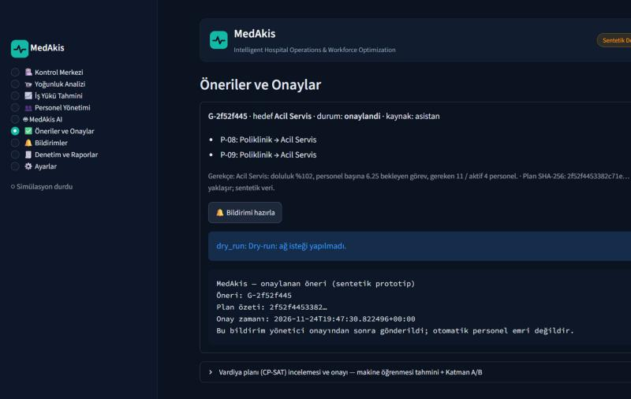
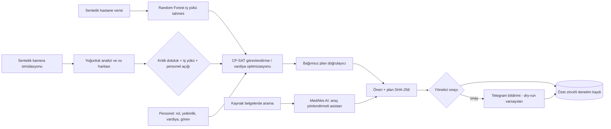

<div align="center">

# MedAkis

### Intelligent Hospital Operations & Workforce Optimization

**Yapay zekâ destekli hastane operasyon merkezi:** hizmet alanlarındaki yoğunluğu izler, iş yükünü öngörür, personel
kısıtlarını koruyarak geçici görevlendirme önerir ve her kararı yönetici onayıyla, denetlenebilir biçimde yürütür.

`Python` · `Streamlit` · `OR-Tools CP-SAT` · `scikit-learn` · `BGE-M3` · `Yerel dil modeli (Gemma 3)` · `Telegram`

</div>


*Gerçek uygulama ekranı: Kontrol Merkezi, sentetik "acil servis yoğunluk artışı" senaryosu.*

> **Prototip:** MedAkis tamamen **sentetik veriyle** çalışan bir karar destek prototipidir; gerçek hastanede doğrulanmamıştır
> ve klinik ürün değildir. Kamera görüntüleri programatik olarak üretilen **sentetik simülasyondur**.

## Çözülen problem

Acil servis bir anda dolduğunda yönetici; hangi alanın gerçekten zorlandığını, hangi serviste personel fazlası olduğunu,
kimin yetkinliğinin ve vardiyasının uygun olduğunu ve aktarımın kaynak servisi riske atıp atmadığını dakikalar içinde
değerlendirmek zorundadır. Bu bilgiler genellikle farklı sistemlerdedir ve karar çoğu zaman sezgiyle verilir.

## MedAkis'in yaklaşımı

- **Algıla:** hizmet alanı doluluğu kamera akışından (bu sürümde sentetik simülasyon) ölçülür ve kat planı üzerinde
  ısı haritası olarak gösterilir.
- **Öngör:** makine öğrenmesi (Random Forest) 30 ve 60 dakikalık iş yükünü tahmin eder.
- **Optimize et:** CP-SAT, rol, yetkinlik, vardiya, aktif görev ve asgari servis kapasitesini koruyarak geçici
  görevlendirme önerir; **bağımsız doğrulayıcı** planı yeniden denetler. Yoğunluk tek başına aktarım gerekçesi değildir:
  kritik doluluk, iş yükü eşiği ve personel açığı birlikte gerekir.
- **İnsan onayı:** sistem hiçbir aktarımı uygulamaz. Öneri plan özetine (SHA-256) bağlanır; yönetici onaylar ya da reddeder.
- **Bildir ve kaydet:** onaylı öneri için bildirim hazırlanır (varsayılan dry-run); her adım özet zincirli denetim
  kaydına yazılır.

## Temel özellikler

| Modül | Ne sunar |
|---|---|
| 🏥 **Kontrol Merkezi** | Simülasyondan hesaplanan KPI'lar, hizmet alanı ısı haritası, yoğunluk ve kapasite grafikleri, operasyonel uyarılar, karar motoru önerisi |
| 📹 **Yoğunluk Analizi** | Sentetik kamera görüntüsü, alan bazında kişi sayısı, kapasite ve doluluk, zaman serisi, başlat/durdur/senaryo kontrolleri |
| 📈 **İş Yükü Tahmini** | Random Forest modeli (yerel eğitim) ve simülasyon projeksiyonu; ikisi ayrı etiketlenir |
| 👥 **Personel Yönetimi** | Sentetik kadro, CP-SAT görevlendirme planı, bağımsız doğrulama, yöneticinin manuel personel seçimi |
| 🤖 **MedAkis AI** | Araç çağıran operasyon asistanı ve kaynaklı bilgi asistanı (belge adı, sürüm ve birebir alıntı; kaynak yoksa kaçınır) |
| ✅ **Öneriler ve Onaylar** | Onay ve ret, plan özeti doğrulaması; ayrıca makine öğrenmesi destekli vardiya planı (Katman A/B) inceleme ekranı |
| 🔔 **Bildirimler** | Telegram bildirim servisi: yalnız onaylı öneri, mükerrer engeli, varsayılan dry-run |
| 🧾 **Denetim ve Raporlar** | Özet zinciri doğrulanmış olay kaydı ve JSON dışa aktarım |



*Gerçek uygulama ekranı: onaylanan görevlendirme önerisi ve dry-run bildirim.*

## Sistem mimarisi



## Örnek kullanım senaryosu

1. **Kontrol Merkezi** açılır; senaryo "Acil servis yoğunluk artışı" seçilidir. **▶ Simülasyonu başlat**.
2. Acil serviste doluluk %100'ü aşar; ısı haritası kırmızıya döner, kritik uyarı oluşur.
3. Karar motoru; iş yükü ve personel açığını da doğrulayarak poliklinikten uygun yetkinlikteki iki personeli önerir.
4. **MedAkis AI**'a "Acil servis neden yoğun?" ve "Personel aktarımının risklerini açıkla" sorulur; asistan araç
   çıktılarıyla yanıtlar.
5. **Öneriyi onaya gönder** → **Öneriler ve Onaylar** → **✅ Onayla**.
6. **🔔 Bildirimi hazırla** → dry-run bildirimi oluşur (Telegram'a gönderim yapılmaz).
7. **Denetim ve Raporlar**'da öneri ve onay olayları, doğrulanmış özet zinciriyle görünür.
8. **MedAkis AI → Kaynaklı bilgi asistanı**: "Katman B'de rezerv nasıl hesaplanır?" → belge, sürüm ve birebir alıntı.

## Kullanılan teknolojiler

| Alan | Teknoloji |
|---|---|
| Arayüz | Streamlit (koyu tema, özel CSS, SVG ısı haritası) |
| Optimizasyon | Google OR-Tools CP-SAT + bağımsız doğrulayıcı |
| Makine öğrenmesi | scikit-learn Random Forest (30/60 dk iş yükü tahmini) |
| Görüntü | NumPy, Pillow, SciPy (sentetik kare üretimi ve renk tabanlı sayım) |
| Bilgi asistanı | Türkçe BM25 kaynak araması; geliştirme kipinde BGE-M3, LAMAR, ModernBERT-TR ve Gemma 3 ile kaynak doğrulamalı RAG |
| Güvenlik ve izlenebilirlik | SHA-256 plan özeti, özet zincirli denetim kaydı, ortam değişkeninden gizli bilgi |

## Hızlı başlangıç

Gereksinim: Windows 10/11 ve Python 3.14 (`py -3.14`). PostgreSQL, Docker ve Ollama **gerekmez**.

```powershell
git clone https://github.com/beyzademirrr/Medakis--son-.git
cd Medakis--son-
.\baslat.ps1
```

Betik sanal ortamı kurar, bağımlılıkları yükler ve Kontrol Merkezi'ni `http://localhost:8501` adresinde açar.

- **Makine öğrenmesi modelleri:** `.\baslat.ps1 -ModelHazirla`. Random Forest modellerini sentetik veriden yerelde
  eğitir (birkaç dakika). Model yokken uygulama sahte tahmin göstermez; durumu açıkça bildirir.
- **Klasik vardiya planı inceleme ekranı:** `.\baslat.ps1 -Klasik`.
- **Telegram:** varsayılan dry-run. Gerçek gönderim yalnız oturum ortam değişkenleriyle mümkündür:
  `MEDAKIS_TELEGRAM_MODE=live`, `TELEGRAM_BOT_TOKEN`, `TELEGRAM_CHAT_ID` (`.env.example`).

Ayrıntılı kurulum, veritabanlı mod ve test komutları: [`docs/TEKNIK_KILAVUZ.md`](docs/TEKNIK_KILAVUZ.md).

## Test ve güvenlik özeti

- **Otomatik testler:** 1.400'ü aşkın test (optimizasyon kısıtları, tahmin sızıntısı, onay akışı, denetim zinciri,
  bildirim güvenliği, ürün prototipi akışları). Teslim sürümünde yeni ürün modüllerinin testleri:
  `tests/test_urun_prototipi.py` ve `tests/test_notifications.py`.
- **Güvenli ret:** kısıtları sağlamayan plan önerilmez; uygun olmayan manuel personel seçimi reddedilir.
- **İnsan onayı:** asistan ve modeller onay veremez; onaysız ya da mükerrer bildirim engellenir.
- **Gizlilik:** yalnız sentetik veri; yüz tanıma, kimlik tespiti ya da sağlık verisi işleme yoktur. Gizli bilgiler
  depoya yazılmaz.

## Prototip kapsamı ve yol haritası

**Bu sürümde:** sentetik kamera simülasyonu ve görüntüden renk tabanlı sayım (gerçek insan tespiti değildir), kural
tabanlı araç yönlendirmeli asistan (dil modeli değildir), BM25 kaynak araması. Kaynak doğrulamalı RAG hattı (BGE-M3 +
reranker + Gemma) geliştirme kipindedir; kabul kriteri henüz karşılanmadığı için kullanıcıya kapalıdır. Ayrıntılı durum:
[`docs/TESLIM_DURUMU.md`](docs/TESLIM_DURUMU.md).

**Yol haritası:** gerçek kamera akışında anonim kişi sayımı · yerel dil modeliyle araç çağıran asistan ve MCP araç
sözleşmeleri · kaynak doğrulamalı RAG'in bağımsız soru setiyle kabulü · gerçek Telegram entegrasyon testi ·
veritabanlı çok kullanıcılı onay akışı.

## Üçüncü taraf bileşenler ve kaynak atfı

MedAkis aşağıdaki açık kaynak yazılımları kullanır; her biri kendi lisansına tabidir. Model ağırlıkları **bu depoda
bulunmaz**; ilgili kaynaktan ayrıca indirilir ve modelin kendi lisans koşulları geçerlidir.

| Bileşen | Kullanım | Lisans |
|---|---|---|
| Streamlit | Kullanıcı arayüzü | Apache-2.0 |
| Google OR-Tools (CP-SAT) | Optimizasyon | Apache-2.0 |
| scikit-learn, pandas, NumPy, SciPy | Tahmin, veri ve görüntü işleme | BSD-3-Clause |
| Pillow | Sentetik kare üretimi | MIT-CMU (HPND) |
| ChromaDB | Vektör deposu (RAG, geliştirme kipi) | Apache-2.0 |
| SQLAlchemy, Alembic, psycopg | Veritabanı katmanı (veritabanlı mod) | MIT / MIT / LGPL-3.0 |
| Ollama | Yerel model sunucusu (geliştirme kipi) | MIT |
| BAAI/bge-m3 | Türkçe metin gömme | MIT |
| Google Gemma 3 4B | Yerel kanıt denetimi (geliştirme kipi) | Gemma Kullanım Koşulları |
| nlpai-lab/LAMAR-600m, ytu-ce-cosmos/modernbert-tr-reranker | Reranker deneyleri | MIT / Apache-2.0 |
| Qwen/Qwen3-Reranker-0.6B, BAAI/bge-reranker-v2-m3 | Karşılaştırma reranker'ları | Apache-2.0 |
| PyTorch, Transformers, sentence-transformers | Reranker deney ortamı (`experiments/d5`) | BSD-3-Clause / Apache-2.0 / Apache-2.0 |

## Yapay zekâ kullanım beyanı

- **Üründe yapay zekâ:** iş yükü tahmini makine öğrenmesiyle (Random Forest) yapılır. Kaynaklı RAG prototipi BGE-M3,
  reranker modelleri ve yerel Gemma 3 4B dil modelini kullanır (geliştirme kipi). Personel optimizasyonu matematiksel
  optimizasyondur (CP-SAT). MedAkis AI operasyon asistanı bu sürümde kural tabanlı araç yönlendirmesidir. Hiçbir bileşen
  personel atamasını kendisi uygulamaz; her öneri yönetici onayı ister.
- **Veri:** bütün veriler sentetiktir; gerçek hasta ya da personel verisi kullanılmamıştır.

Telif Hakkı © 2026 Beyza Demir. Tüm Hakları Saklıdır.
